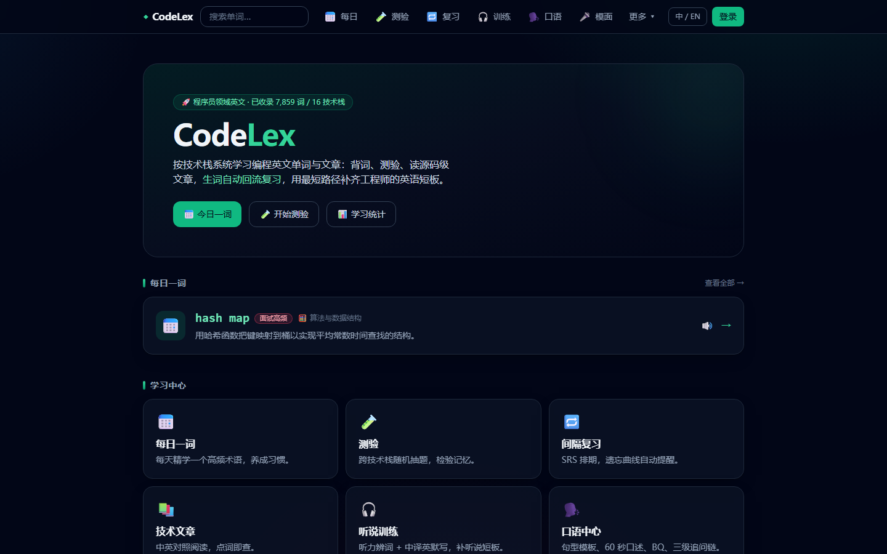
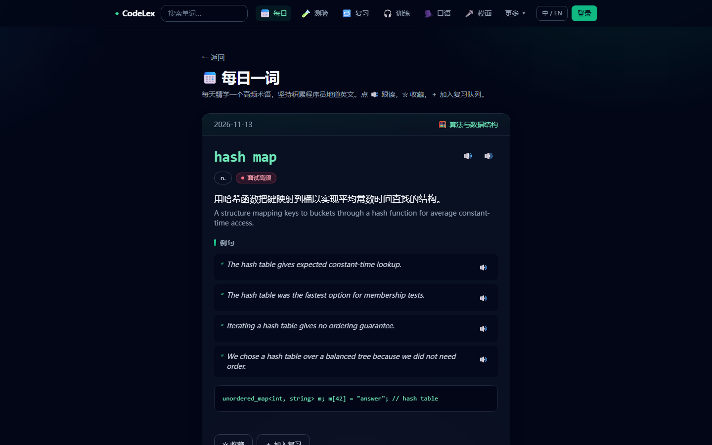
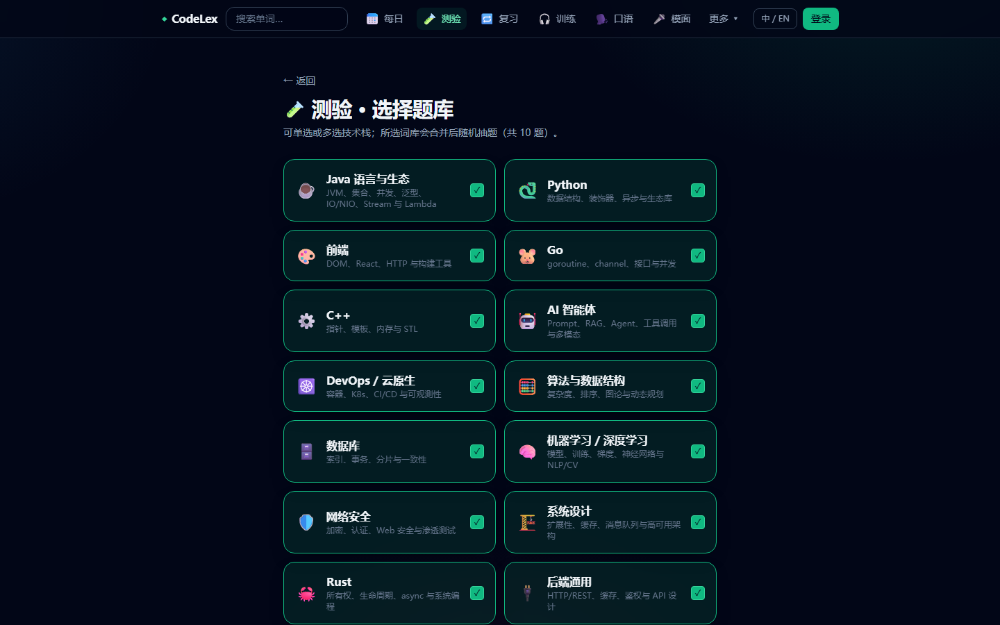
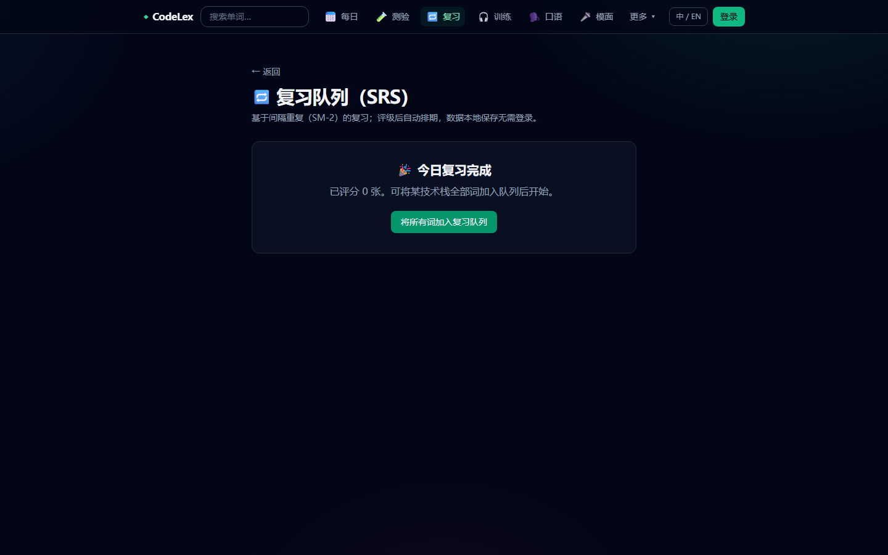
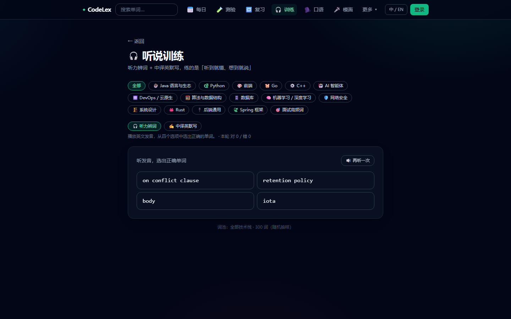
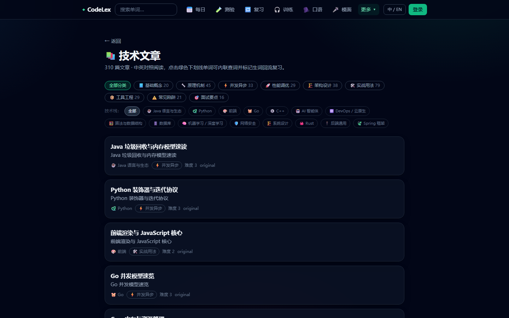
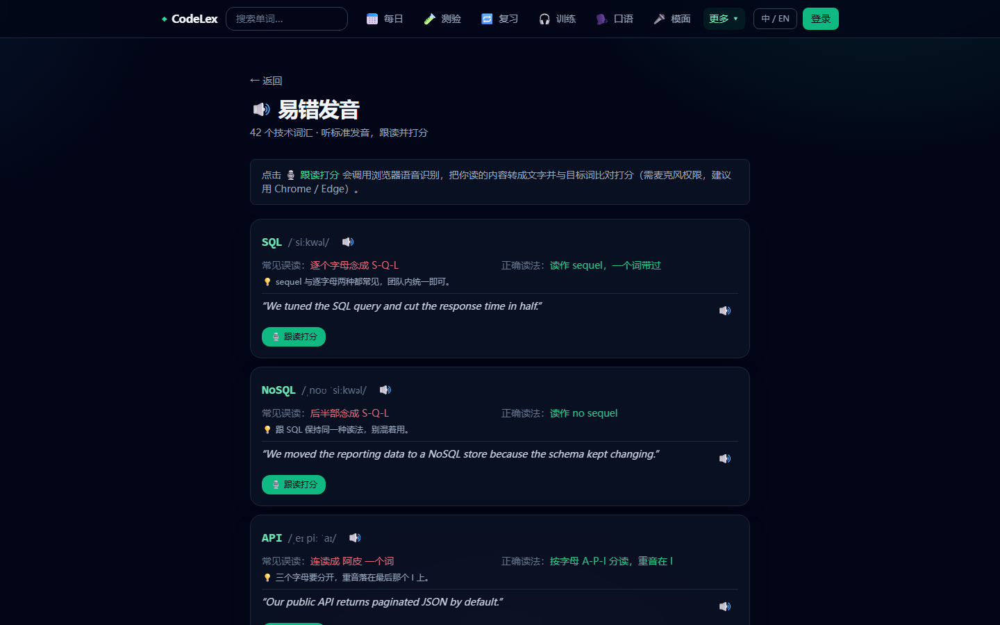
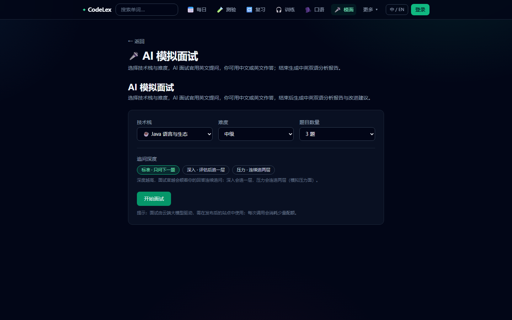
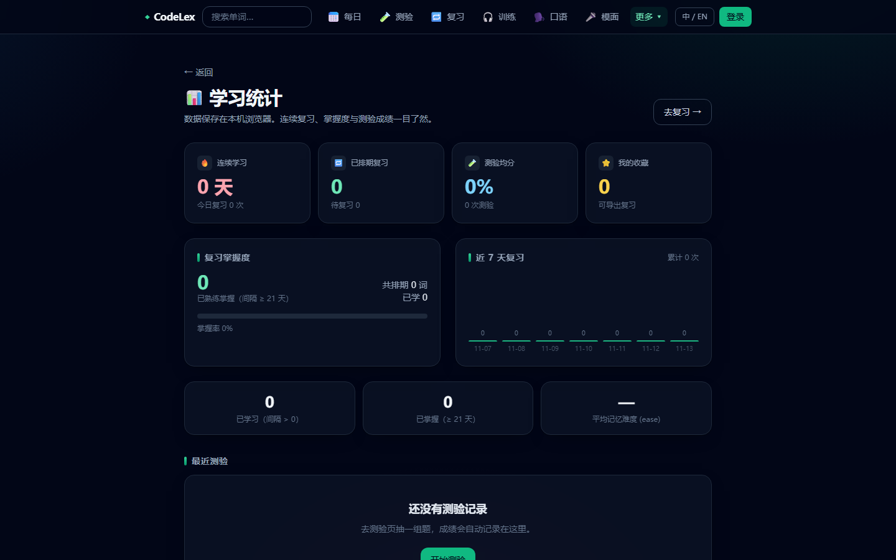

# CodeLex · 程序员领域英文学习

> 面向程序员、按技术栈组织的英文单词与文章学习站。
> 参赛项目：WorkBuddy「1024 造物挑战」程序员节应用创作大赛。

**🌐 在线体验：[codelex-word-learn.app.workbuddy.host](https://codelex-word-learn.app.workbuddy.host/?sharecode=CDUOZ7NRQL)**

## 界面预览

**首页 · 学习中心**



| 每日一词 | 测验 · 选择题库 |
| --- | --- |
|  |  |

| SRS 间隔复习 | 听说训练 |
| --- | --- |
|  |  |

| 技术文章（内联查词） | 发音中心 |
| --- | --- |
|  |  |

| AI 模拟面试 | 学习统计 |
| --- | --- |
|  |  |

## 核心闭环

按技术栈背词 → 测验巩固（SRS 间隔重复）→ 阅读技术文章时内联查词 / 标记生词回流复习。

- **按栈学词**：16 个技术栈（Java / Python / 前端 / Go / C++ / AI 智能体 / DevOps / 算法 / 数据库 / 机器学习 / 网络安全 / 系统设计 / Rust / 后端通用 / Spring 规范 / 基础概念），累计收录 7,859 词，全部来自真实面试语境。
- **SRS 复习**：测验错题与阅读中生词自动进入复习队列，按遗忘曲线间隔排期，到期自动提醒。
- **文章内联查词**：310 篇中英对照技术文章，点击划线单词即查即标，生词回流复习闭环。
- **听说训练**：TTS 朗读 + 中译英写，补听说短板；发音中心覆盖句型模板、60 秒陈述、BO 算法追问。
- **AI 模拟面试**：选择技术栈与难度，AI 面试官用英文追问，支持三种追问深度（标准 / 深入 / 压力面），结束生成中英双语分析报告。

## 快速开始（零数据库）

```bash
npm install
npm run dev
# 打开 http://localhost:3000
```

首批词库以 JSON 形式置于 `data/seed/<slug>.json`，由 `src/lib/wordData.ts` 直接读取，**无需数据库即可运行**。

## 校验词库完整性

```bash
npm run validate:seed
```

## 数据存储说明

发布版本为**零数据库**运行：词库读取 `data/seed/*.json`，学习进度（复习 / 收藏 / 错题 / 统计）保存在浏览器 `localStorage`，无需任何后端配置即可使用。若需跨设备同步，可接入 Supabase（在 `.env` 填写 `NEXT_PUBLIC_SUPABASE_URL` 与 `NEXT_PUBLIC_SUPABASE_ANON_KEY`，参考 `.env.example`，表结构见 `supabase/schema.sql`）。

多账号场景下学习数据按用户 ID 隔离（`src/lib/scope.ts`）。

## 技术栈

- [Next.js](https://nextjs.org/) 14（App Router）+ TypeScript
- Tailwind CSS（深色 emerald 主题）
- Supabase（可选，登录与云同步）
- Vite（`xhs-minitool` 小红书小工具子项目）

## 目录结构

- `app/` Next.js App Router 页面与 API 路由
- `src/components/` 客户端组件（测验 / 复习 / 阅读 / 模面等）
- `src/lib/` 核心逻辑（SRS / 词库读取 / 多账号数据隔离 / TTS）
- `src/types/` 共享类型（词库数据格式）
- `data/seed/<slug>.json` 各技术栈词库
- `data/stacks.json` 技术栈元数据
- `data/articles-*.json` 技术文章语料
- `supabase/` 可选云同步的表结构
- `xhs-minitool/` 小红书小工具（Vite 子项目）
- `docs/` 需求文档与数据规范

## 词库数据格式

详见 `docs/word-data-spec.md`。
